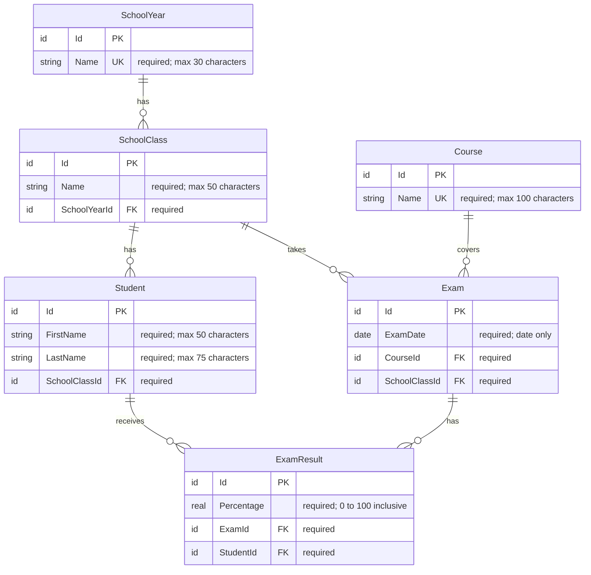

# Grader Database

## ER Diagram

## Constraints and Rules

- Id columns use auto-generated integers (surrogate keys).
- SchoolYear.Name must be unique.
- SchoolClass.Name must be unique within a SchoolYear.
- Course.Name must be unique.
- Exam must be unique for a given Course, SchoolClass, and ExamDate.
- ExamResult must be unique for a given Exam and Student.
- No cascading deletes are allowed. If a record is referenced by another record, it cannot be deleted.
- ExamResult.Percentage must be between 0 and 100 inclusive.

All constraints must be enforced by the database.

## Test Data Generator

Populates an empty database with sample data. Algorithm must throw an error if DB is not empty (i.e. all used tables must have zero rows).

### School Year

School years always span two calendar years (summer to summer), e.g., 2025/26. Generate three school years ending in the one where the current year is the first part, e.g., if the current year is 2026, generate 2024/25, 2025/26, and 2026/27.

### School Class

School classes have a numeric grade level followed by a letter for the class within that level, e.g., 1A, 2B. For each school year, generate 4 levels (1-4), 1 and 2 with A-C, 3 and 4 with A-B.

### Students

Use Bogus to generate student data. For each school class, generate 20 students with realistic first and last names.

### Courses

For our test data, generate the following courses:

- Mathematics
- English
- History
- Computer Science
- Physical Education

### Exams

In each course, class, and school year, we have four exams. Generate exam dates spread evenly throughout the school year (between September and June). Exam dates may be in the future.

### Exam Results

For each exam generate random exam results (even for future exams, does not matter for testing). Generate exam percentages in the range 0–100 from a bounded, approximately normal distribution. The distribution’s mean shall be 75, and approximately 10% of generated percentages shall be at least 90. Thus, a cohort of 20 is expected to have about two percentages >= 90, though individual cohorts may vary.

For each exam, 2 students must NOT have a result (randomly selected).
